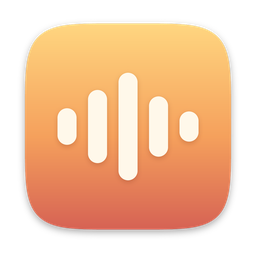
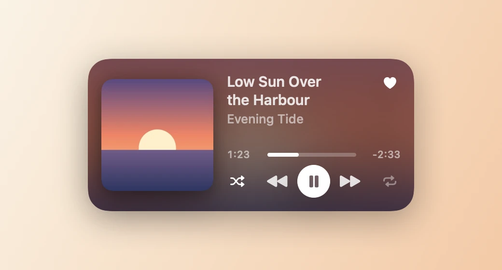

<h1 align="center">Music Widget </h1>

<p align="center">
  A desktop widget for macOS that shows what's playing in Apple Music, with back, play/pause and skip.
</p>

<p align="center">
  
  
  
</p>

<p align="center">
  <picture>
    <source media="(prefers-color-scheme: dark)" srcset="docs/hero-dark.webp">
    
  </picture>
</p>

## Install

1. Download `MusicWidget.zip` from the [latest release](https://github.com/Sir-Monke/MusicWidget/releases/latest) and unzip it.
2. Open **Music Widget**. It moves itself into Applications and starts at login. It has no window.
   If macOS won't open it the first time, go to System Settings › Privacy & Security and click **Open Anyway**.
3. Click **OK** when macOS asks to let Music Widget control Music.
4. Right-click the desktop, choose **Edit Widgets…**, search **Music Widget** and add it.

## What it does

- **Two tiles wide.** Album cover on the left, song and artist on the right, controls underneath.
- **Shows where you are.** A progress bar with time played and time left, running live.
- **Keeps up.** Slides to the next song the moment Music skips, pauses or moves on.
- **Controls Music.** Back, play/pause and skip, plus shuffle, repeat and favourite, straight from the desktop.
- **Private.** Talks only to Music on your Mac. When a streamed song has no cover, it looks one up on the iTunes Search API.

## How it works

A widget can't talk to Music, so the app does it for the widget. It reads Music with AppleScript, saves the song to `~/Library/Application Support/MusicWidget/now-playing.json` and tells the widget to refresh. The widget's buttons send commands back to the app.

## Build from source

Open `MusicWidget.xcodeproj` in Xcode and press Run. Music Widget copies itself into Applications, opens from there and starts at login. To check the logic:

```sh
/Applications/MusicWidget.app/Contents/MacOS/MusicWidget --selftest
```

To redraw the images above, tick the `--render-docs` argument under Edit Scheme › Run › Arguments and press Run. They're saved as PNGs in `docs/frames`.

## Thanks

[swift-apple-music-widget](https://github.com/cgroening/swift-apple-music-widget) for showing that Apple Music songs outside your library answer some questions and refuse others, so each one has to be asked separately.

## Remove

Remove the widget from the desktop, quit Music Widget in Activity Monitor, then drag it from Applications to the Bin.

## Licence

[MIT](LICENSE)
